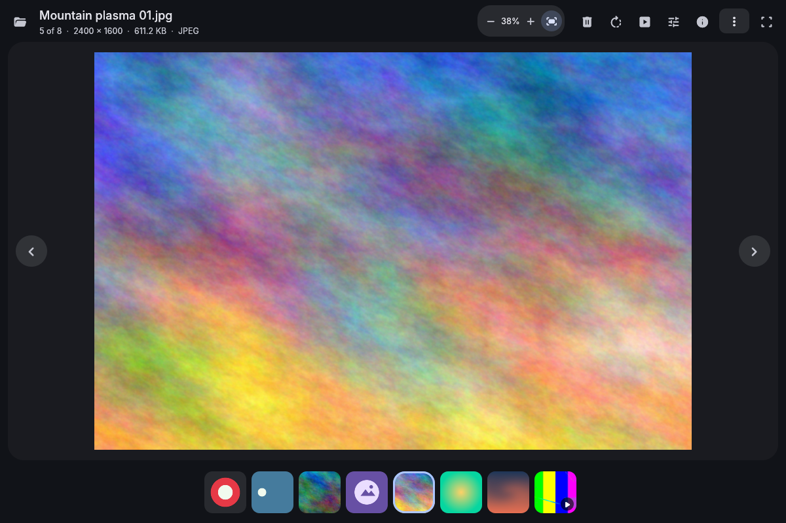
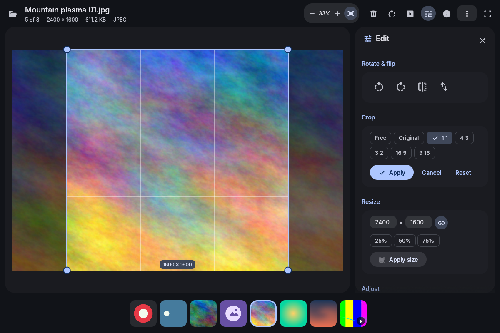
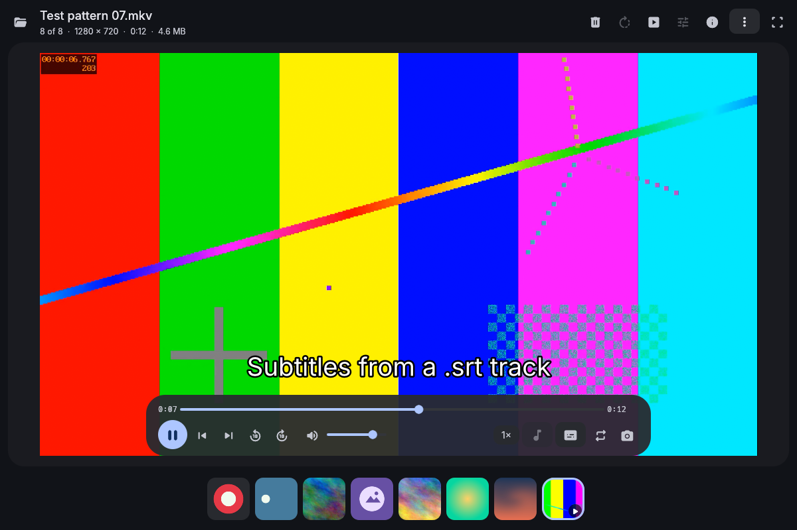
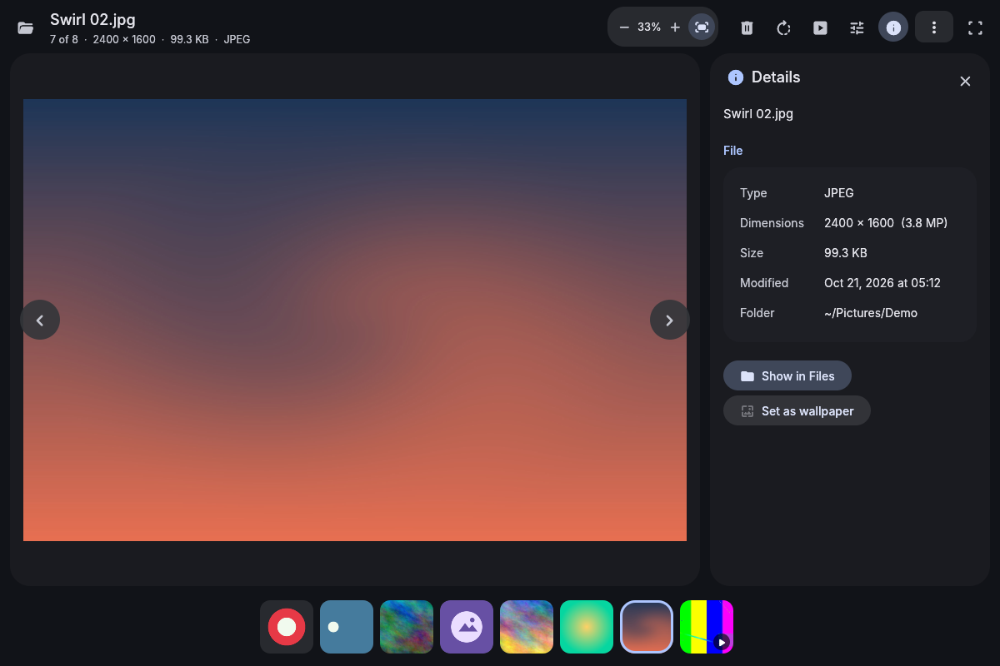

# Material 3 Viewer

A picture and video viewer for Arch Linux, built with [egui](https://github.com/emilk/egui) and themed with Material You. It shares its look, widgets and fonts with the other Material 3 apps through [material-3-ui](https://github.com/bhimio1/material-3-ui), and on an end4-pC desktop it takes its colors from your wallpaper, like the shell does.






## Features

**Browsing**
- Open a file to step through its folder with ← and →. The folder is sorted the same way as the file manager ("img2" comes before "img10"). You can also open a folder, drop a file onto the window, or use the Open dialog (through the XDG portal).
- A filmstrip of thumbnails runs under the picture. Video thumbnails come from ffmpegthumbnailer or ffmpeg.
- Fullscreen (F11 or double-click) and a slideshow. Videos in a slideshow play to the end before it moves on.
- The details sheet shows type, dimensions, size, date and folder. For photos it adds the camera, lens, exposure, aperture, ISO, focal length, date taken and GPS position from EXIF.

**Pictures**
- PNG (including animated APNG), JPEG, GIF and WebP (both animated too), BMP, TIFF, ICO, TGA, PNM, QOI, HDR and SVG. Camera RAW files (CR2, NEF, ARW, DNG, ORF, RAF, …) open through their embedded preview, or fully decoded when built with `--features raw`.
- EXIF orientation is applied.
- Zoom with the wheel, by pinching, with + / − / 0, or with the zoom buttons. Drag to pan. Double-click switches between fit and 100%.
- Decoding happens off the UI thread. The neighbouring pictures are decoded ahead, so stepping through a folder is instant. Pictures bigger than the GPU's texture limit are scaled down to fit it.
- Transparent pictures sit on a checkerboard.

**Edits** (nothing touches the file until you save)
- Rotate and flip.
- Crop, freely or to 1:1, 4:3, 3:2, 16:9, 9:16 or the original ratio.
- Resize, with presets, by pixels, or keeping proportions.
- Brightness, contrast and saturation.
- **Save** writes over the original after asking. **Save as** writes a new file in PNG, JPEG or WebP.

**Videos**
- libmpv draws the video inside the window, using mpv's OpenGL render API. You get Material controls for:
  - play/pause, seeking, ±10 s, and frame steps;
  - volume and speed;
  - subtitle and audio tracks;
  - looping;
  - saving the current frame as a PNG.
- When mpv is missing, an Install button opens your terminal to install it.

**Actions**
- **Set as wallpaper:** uses end4-pC's `switchwall.sh`, which also recolors the desktop and every Material 3 app to match (it takes videos too). Without end4-pC it uses swww or hyprpaper.
- **Copy image:** puts the picture, with your edits, on the clipboard as PNG (wl-copy, or xclip on X11).
- **Show in Files:** opens the folder in the Material 3 File Manager (`m3fm`), or your default file manager.
- **Move to trash:** sends the file to the freedesktop trash, so it can be restored.

## Keys

| Key | Action |
| --- | --- |
| ← / → | previous / next (Shift: seek 5 s in videos) |
| Home / End | first / last |
| Space | play / pause, or next picture |
| , / . | previous / next video frame |
| + / − / 0 | zoom in / out / actual size |
| F | fit to the window |
| F11 | fullscreen |
| R / Shift+R | rotate right / left |
| E / I | edit / details |
| M | mute |
| Ctrl+O | open |
| Ctrl+S / Ctrl+Shift+S | save / save as |
| Ctrl+C | copy image |
| Delete | move to trash |
| Esc | leave crop, slideshow, fullscreen, then the side sheet |

## Install

From the AUR, prebuilt or built from source:

```sh
paru -S material-3-viewer-bin   # or material-3-viewer-git
```

On end4-pC, Material 3 Settings installs and updates it for you.

From this repository, with the included PKGBUILD:

```sh
cd packaging
makepkg -si
```

Prebuilt x86_64 binaries are attached to [releases](https://github.com/bhimio1/material-3-veiwer/releases).

Or build directly:

```sh
cargo build --release              # add --features raw for full RAW decoding
./target/release/m3-viewer [FILE | FOLDER]
```

`material_3_viewer.desktop` registers the viewer for image and video types, so you can make it the default in Material 3 Settings → Default apps, or with `xdg-mime default material_3_viewer.desktop image/png`.

Optional tools:
- `mpv`: videos (libmpv is loaded at run time, so the viewer starts without it);
- `ffmpegthumbnailer` or `ffmpeg`: video thumbnails;
- `wl-clipboard`: Copy image;
- `xdg-desktop-portal`: the Open and Save as dialogs;
- `swww` or `hyprpaper`: wallpapers without end4-pC.

## Preferences

Preferences are in the ⋮ menu:
- the shared Appearance card;
- whether pictures open at Fit, Fill or 100%;
- the slideshow interval;
- the filmstrip;
- the trash confirmation;
- looping videos;
- the wallpaper tool.

**Auto** colors use end4-pC's generated palette (`~/.local/state/quickshell/user/generated/colors.json`) and follow it live. Preferences are stored in `~/.config/m3-viewer/config.toml`.

## Project layout

```
src/
  app.rs       window state, navigation, keyboard, background jobs
  media.rs     supported formats, natural sort, the folder being viewed
  decode.rs    still and animated images, SVG, RAW, video thumbnails
  loader.rs    background decoding, preloading and the thumbnail cache
  edit.rs      the edit recipe: rotate, flip, crop, resize, adjust, save
  exif.rs      camera details and orientation
  actions.rs   wallpaper, clipboard, file manager, trash
  config.rs    ~/.config/m3-viewer/config.toml
  video/       libmpv (loaded at run time) and its OpenGL render API
  ui/          top bar, canvas, filmstrip, video controls, side sheets
```

Run the tests with `cargo test`.

## License

MIT, see [LICENSE](LICENSE).

Fonts: Inter (SIL OFL 1.1, see `assets/fonts/LICENSE-Inter.txt`). Icons: Material Symbols, via `egui_material_icons`.
